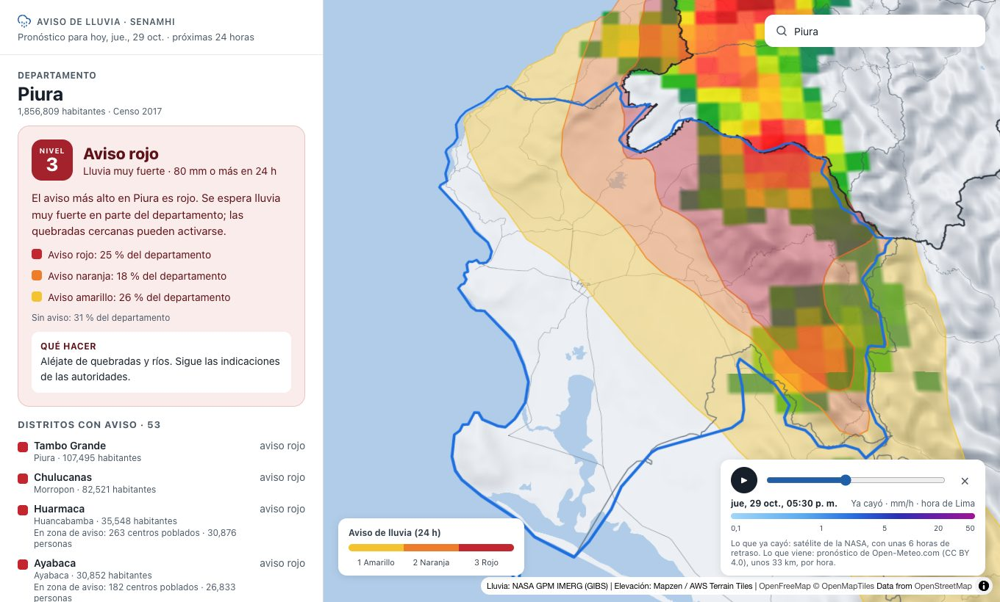
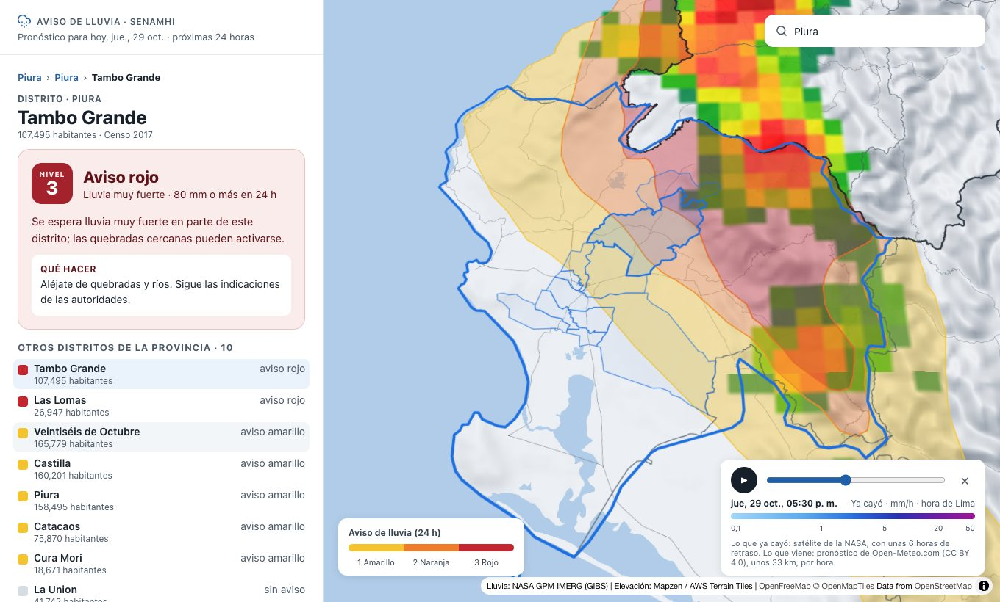
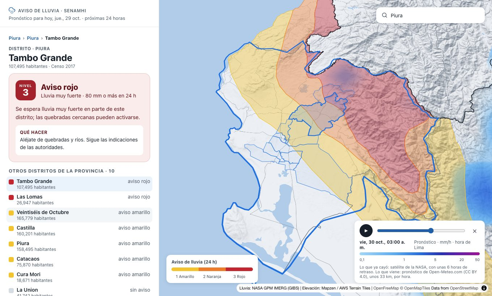
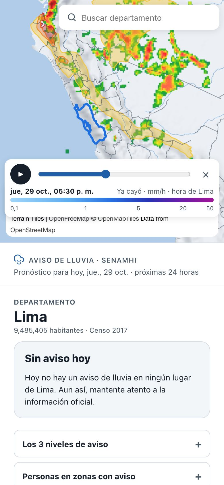

[Español](README.md) | **English**

<p align="center">
  <picture>
    <source media="(prefers-color-scheme: dark)" srcset="branding/chakana-mark-for-dark-backgrounds.svg">
    
  </picture>
</p>

# Perú Alerta Lluvia

[](https://alerta.illapalabs.org)
[](LICENSE)

**Site: [alerta.illapalabs.org](https://alerta.illapalabs.org)**

A map of the areas of Peru under a heavy rain warning, built on information from SENAMHI (the national meteorology and hydrology service). It shows the warning by department, province and district, how many people live in areas with a ravine-activation warning, the rain of the last hours and the forecast.

> **This is not an official site.** The source of the warnings is [SENAMHI](https://www.senamhi.gob.pe). In an emergency, call 115 (INDECI) or 116 (Fire Department) in Peru.


A project of [Illapa Labs](https://github.com/Illapa-Labs): a community open source project, with no ads and not for profit.

## What it shows

### The warning for your department

Search for your district, province or department, or tap it on the map. For a department, the panel shows the highest warning level, how much of the department each level covers, what to do, and the districts with a warning, with their population and how many people live where ravines may activate.



### Down to your district

Tapping the map goes down one step at a time: from department to province, and from province to district. Each district shows its warning and what to do, and the breadcrumbs at the top lead back.



### Rain: what fell and what is coming

A slider runs through the last 24 hours of rain seen by satellite (NASA) and the next 24 hours of forecast (Open-Meteo), hour by hour, under the warning areas.



### On a phone

Made to be read quickly and on slow connections: the panel shows before the map, which is the heaviest part.

<p align="center"></p>

## Status and roadmap

Under construction. The site is static and light: it asks the [Illapa API](https://github.com/Illapa-Labs/illapa-engine) for the warning, the districts and the forecast, and only keeps the department boundaries and district shapes, which hardly change.

| Stage | Status |
|---|---|
| Repository with AGPL license, guides and branching workflow | Done |
| Document the data sources and their licenses ([DATOS.en.md](DATOS.en.md)) | In progress |
| Migrate the prototype code and read the data from the API | Done |
| Illapa API (`illapa-engine`): warning, districts and forecast | Done |
| GOES-19 satellite rainfall from the API (NASA's is used for now) | Pending |
| Publish the API (`api.illapalabs.org`) and the site (`alerta.illapalabs.org`) | Done; the old prototype is still to be retired |
| Research kit (`illapa-research`) | Pending |

## Running locally

You need [Bun](https://bun.sh) and the [Illapa API](https://github.com/Illapa-Labs/illapa-engine) running on `http://127.0.0.1:8080` (see its README).

```bash
bun install
bun run start
```

The API address is in `.env.development` (locally) and `.env.production` (when building the site). Before sending changes: `bun run typecheck` and `bun run build`.

## Publishing

The site is at https://alerta.illapalabs.org: static files on Cloudflare (`wrangler.jsonc`), with no server code.

It publishes itself: Cloudflare (Workers Builds) builds and publishes every change that reaches `main`, and every pull request gets a preview address without touching the public version. To publish by hand, for example if Workers Builds fails:

```bash
bun run build
npx wrangler deploy
```

## Data and attribution

The warnings, population, satellite rainfall, forecast and base map come from third-party sources, each with its own terms. They are listed, with their status, in [DATOS.en.md](DATOS.en.md). This project does not own that data and does not guarantee it.

## License

This program is free software: it is distributed under the [GNU Affero General Public License, version 3 or later](LICENSE) (`AGPL-3.0-or-later`).

If you use this code, or a modified version of it, to offer a service over a network, you must offer its complete source code to the users of that service, also under the AGPL.

The license covers the code in this repository, **not the data**. The data carries the license of each source.

## Contributing

Read [CONTRIBUTING.en.md](CONTRIBUTING.en.md): it explains what helps most, how to send changes and the branching workflow. Everyone who takes part agrees to follow the [Code of Conduct](CODE_OF_CONDUCT.en.md).

## Contact

contacto@illapalabs.org
