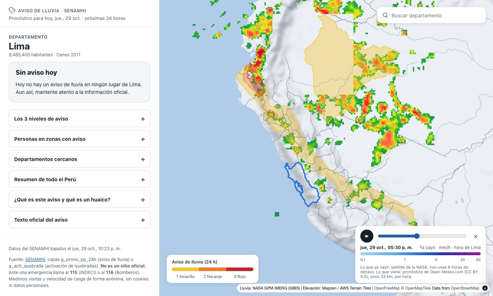

**Español** | [English](README.en.md)

<p align="center">
  <picture>
    <source media="(prefers-color-scheme: dark)" srcset="branding/chakana-mark-for-dark-backgrounds.svg">
    
  </picture>
</p>

# Perú Alerta Lluvia

[](LICENSE)

Mapa de las zonas del Perú con aviso de lluvias fuertes, con la información del SENAMHI. Muestra el aviso por departamento, provincia y distrito, cuánta gente vive en las zonas con aviso de activación de quebradas, la lluvia de las últimas horas y el pronóstico.

> **No es un sitio oficial.** La fuente de los avisos es el [SENAMHI](https://www.senamhi.gob.pe). Ante una emergencia llama al 115 (INDECI) o al 116 (Bomberos).



Un proyecto de [Illapa Labs](https://github.com/Illapa-Labs): proyecto comunitario de código abierto, sin anuncios y sin fines de lucro.

## Estado y hoja de ruta

En construcción. La web es un sitio estático y ligero: el aviso, los distritos y el pronóstico los pide a la [API de Illapa](https://github.com/Illapa-Labs/illapa-engine), y en el sitio solo quedan los límites de los departamentos y las formas de los distritos, que casi no cambian.

| Etapa | Estado |
|---|---|
| Repositorio con licencia AGPL, guías y flujo de ramas | Hecho |
| Documentar las fuentes de datos y su licencia ([DATOS.md](DATOS.md)) | En curso |
| Migrar el código del prototipo y leer los datos de la API | Hecho |
| API de Illapa (`illapa-engine`): aviso, distritos y pronóstico | Hecho |
| Lluvia del satélite GOES-19 desde la API (por ahora se usa la de la NASA) | Pendiente |
| Publicar la API y la web | Pendiente |
| Kit de investigación (`illapa-research`) | Pendiente |

## Correr en local

Necesitas [Bun](https://bun.sh) y la [API de Illapa](https://github.com/Illapa-Labs/illapa-engine) corriendo en `http://127.0.0.1:8080` (ver su README).

```bash
bun install
bun run start
```

La dirección de la API está en `.env.development` (en local) y `.env.production` (al construir el sitio). Antes de enviar cambios: `bun run typecheck` y `bun run build`.

## Datos y atribución

Los avisos, la población, la lluvia de satélite, el pronóstico y el mapa base vienen de fuentes de terceros, cada una con sus propios términos. Están listadas, con su estado, en [DATOS.md](DATOS.md). Este proyecto no es el dueño de esos datos ni los garantiza.

## Licencia

Este programa es software libre: se distribuye bajo la [GNU Affero General Public License, versión 3 o posterior](LICENSE) (`AGPL-3.0-or-later`).

Si usas este código, o una versión modificada, para ofrecer un servicio por red, debes ofrecer su código fuente completo a los usuarios de ese servicio, también bajo la AGPL.

La licencia cubre el código de este repositorio, **no los datos**. Los datos tienen la licencia de cada fuente.

## Cómo colaborar

Lee [CONTRIBUTING.md](CONTRIBUTING.md): explica qué ayuda más, cómo enviar cambios y el flujo de ramas. Todas las personas que participan se comprometen a respetar el [Código de Conducta](CODE_OF_CONDUCT.md).

## Contacto

contacto@illapalabs.org
